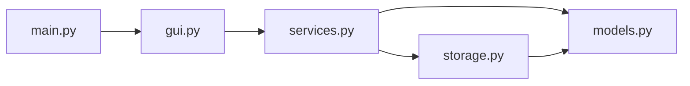

<div align="center">

# Фітнес-планувальник

**Настільний застосунок для планування тренувань, обліку виконаного обсягу та тижневої аналітики «План і факт».**

</div>

---

<!-- Додайте скриншот вікна програми у папку docs/ і розкоментуйте рядок нижче:
<p align="center">
  
</p>
-->

## Можливості

- **Облік тренувань** — додавання записів із датою (`ДД.ММ.РРРР` або `РРРР-ММ-ДД`), назвою вправи, тривалістю та кількістю повторень.
- **Контроль виконання** — швидке перемикання статусу («Заплановано» / «✓ Виконано») та видалення записів із підтвердженням.
- **Пошук і фільтрація** — миттєвий пошук за конкретною датою або частиною назви вправи без урахування регістру.
- **Тижнева статистика (Пн–Нд):**
  - *Підсумок тижня* — кількість виконаних тренувань та сумарний час у хвилинах.
  - *План і факт* — порівняння запланованого й виконаного обсягу в тренуваннях, хвилинах і повтореннях із візуальним індикатором прогресу.
- **Захист даних** — валідація введення, захист від дублікатів (дата + вправа), атомарний запис у JSON через тимчасовий файл та автоматичний карантин пошкодженого файлу (`workouts.broken.json`).

---

## Швидкий старт

### Вимоги

- Python **3.10+**
- Бібліотека **Flet** (інші модулі — `datetime`, `json`, `os` — входять до стандартної бібліотеки)

### Встановлення та запуск

```bash
# 1. Клонуйте репозиторій
git clone https://github.com/<your-username>/fitness-planner.git
cd fitness-planner

# 2. Встановіть залежності
pip install -r requirements.txt

# 3. Запустіть застосунок
python main.py
```

### Запуск тестів

```bash
python test_services.py
```

Проєкт містить **10 автоматичних тестів** (5 позитивних, 2 негативних, 3 граничних), які перевіряють бізнес-логіку, межі значень, пошук, межі тижня та обробку помилок.

---

## Архітектура

Застосунок розділений на незалежні шари без циклічних залежностей — бізнес-логіка повністю відокремлена від графічного інтерфейсу:



```text
fitness-planner/
├── main.py             # Точка входу
├── gui.py              # Графічний інтерфейс (Flet)
├── services.py         # Бізнес-логіка, пошук, статистика, клас Planner
├── storage.py          # Атомарне читання/запис JSON та обробка збоїв
├── models.py           # Модель Workout, обмеження полів і ValidationError
├── test_services.py    # Автоматичні тести для services.py
├── requirements.txt    # Залежності проєкту
└── data/
    └── workouts.json   # Локальне сховище (створюється автоматично)
```

---

## Модель даних

Дані зберігаються у файлі `data/workouts.json` у форматі списку об'єктів `Workout`:

| Поле | Тип | Обмеження |
| --- | --- | --- |
| `date` | `str` (`ISO`) | `01.01.2000` – `31.12.2100` (у GUI: `ДД.ММ.РРРР` або `РРРР-ММ-ДД`) |
| `exercise` | `str` | 1–50 символів; зайві пробіли та невидимі символи видаляються |
| `duration` | `int` | `1` – `600` хв |
| `reps` | `int` | `0` – `1000` (`0` — для циклічних вправ на кшталт бігу) |
| `done` | `bool` | `true` / `false` |

```json
[
  {
    "date": "2026-11-25",
    "exercise": "Присідання",
    "duration": 30,
    "reps": 40,
    "done": true
  },
  {
    "date": "2026-11-26",
    "exercise": "Біг",
    "duration": 45,
    "reps": 0,
    "done": false
  }
]
```

---
